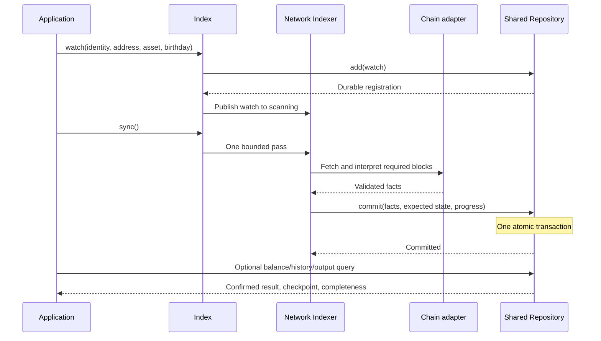

# Architecture

Current owners and invariants; exact APIs live in the crate READMEs and source.
Product acceptance lives in [SYSTEM_REQUIREMENTS.md](docs/SYSTEM_REQUIREMENTS.md).

## Crates

| Crate | Path | Purpose | Layer | README |
|---|---|---|---|---|
| `crypto` | `packages/crypto` | Secret key material, secp256k1 and Ed25519 keys, ECDSA/Schnorr/Ed25519 signing, the signing request/result vocabulary, and the in-process key pair every chain signs through | packages | [README](packages/crypto/README.md) |
| `decimal` | `packages/decimal` | Exact base-10 amounts: canonical positional text, numeric ordering, atomic-unit conversion | packages | [README](packages/decimal/README.md) |
| `json-rpc` | `packages/json-rpc` | Bounded JSON-RPC transport: one URL per node; retry and failover are decorators | packages | [README](packages/json-rpc/README.md) |
| `http-server` | `packages/http-server` | Axum server hardening: bearer auth, transport security, limits; application-supplied health routes | packages | [README](packages/http-server/README.md) |
| `sdk-config` | `sdk/config` | The configuration document and the registry that hands each named section to the chain that registered for it; `Rpc`, `Repetition`, `Cadence` as plain data; TOML behind feature `toml` (off by default). It names no chain crate | config | [README](sdk/config/README.md) |
| `base` | `sdk/base` | Chain-neutral values and capabilities: address, network, asset, amount, block, sign, broadcast | base | [README](sdk/base/README.md) |
| `indexing` | `sdk/indexing` | Append-only, chain-neutral sync into history, checkpoint, and outputs, with pending blocks in memory; optional SQLite/memory repositories and Tokio supervision | indexing | [README](sdk/indexing/README.md) |
| `wallets` | `sdk/wallets` | Wallet factory contract and the `Wallets` registry: sends, batches, and consumer-side pending balance/history/output joins | wallets | [README](sdk/wallets/README.md) |
| `chain-bitcoin` | `sdk/chains/bitcoin` | Bitcoin: RPC, blocks, UTXO wallets, send pipeline | chains | [README](sdk/chains/bitcoin/README.md) |
| `chain-ethereum` | `sdk/chains/ethereum` | Ethereum: RPC, blocks, ETH and ERC-20 wallets, send pipeline | chains | [README](sdk/chains/ethereum/README.md) |
| `chain-solana` | `sdk/chains/solana` | Solana: RPC, finalized blocks, SOL wallets, send pipeline | chains | [README](sdk/chains/solana/README.md) |
| `payment-server` | `apps/server` | The one application, a binary with no library target: config, storage, chain composition, supervision, and the HTTP routes, wire models, and OpenAPI contract it serves (`src/api/`, over `wallets` and `indexing`; no chain, no storage) | server | [README](apps/server/README.md) |
| `payment-examples` | `examples` | Runnable scenarios: one directory per scenario, every chain inside it as setup | examples | [README](examples/README.md) |


## Boundaries

- Packages import packages, never SDK or applications. `base` imports no RPC,
  indexing, wallets or concrete chain. Concrete chains do not import one another.
- `apps/server` is the only application binary. Only its `src/chains.rs` selects
  concrete chains; `src/api/` names neither chains, configuration parsing nor
  indexing backends. Nothing depends on the server.
- Each chain owns its protocol, native RPC, parsing, signing, finality and send
  pipeline. `native/` knows no SDK indexing/wallet model. Adapters translate at
  that boundary; shared values do not become a universal transaction/RPC model.
- Configuration owns documents, endpoint construction and chain registration.
  Each chain interprets its own section. Every node identity is verified before
  storage opens. Direct Rust construction remains available without a parser.
- Wallet factories own construction and validation; `Wallets` collects factories,
  not wallet instances, IDs or secrets. The application owns custody and its
  signing map. Display units are keyed by exact `(Network, AssetId)`.
- Indexing owns observation and scanning. Repositories own persisted facts and
  queries. Continuous execution is optional; callers can drive bounded passes.

### Dependency direction

```text
server/examples -> chains, config, wallets, indexing, base, packages
chains          -> config, wallets, indexing, base, packages
config          -> wallets, indexing, base, json-rpc
wallets         -> indexing, base, crypto
indexing        -> base (+ optional SQLite and Tokio)
base            -> crypto, decimal
```

`linter.toml` and `scripts/check-chains.sh` enforce crate and module boundaries.
Within `indexing/src/storage/`, each directory is one backend with `mod.rs`;
shared contracts/models are files directly under `storage/`. The engine and
shared storage code never import backend internals. SQLite and memory are
independently feature-gated, shipped implementations. Contract suites live in
`indexing/tests/`; memory is useful beyond testing.

## Indexing and repositories

One caller-supplied repository serves all networks, including third-party
implementations. Its required contract is `WatchStore + IndexStore`; balance,
history, outputs and offline purge are optional consumer capabilities.

`Indexer` owns one network's watches, pending `Blocks`, chain adapter and
repository reference. `Index` routes across them. Native-block caching is
separate from validated facts. The pass is a procedure over this state, not
another state owner. Chain interpreters emit facts, never SQL or stored records.



A watch contains identity, address, asset and inclusive birthday, never keys.
Persist it before publishing it to the hot set; admission coordinates observation
with active passes. Unwatch removes the observation, not previously indexed facts.

Per-watch progress proves contiguous inspection, including blocks with no matching
activity. Resume after saved progress or at the birthday. New watches do not reset
old ones. Behind watches catch up from their lowest required position using shared
fetches; they join forward selection only when caught up. Forward work gets the
bounded pass budget first. Reads must expose incomplete catch-up honestly.

Native position controls traversal, birthdays and restart; produced height controls
confirmation. Solana slots may be sparse. Block references retain hash and paired
parent position/hash; verify persisted hashes before resuming.

Each chain supplies its confirmed boundary: Bitcoin configured depth, Ethereum
finalized block, Solana rooted block. Commit only confirmed facts. Pending facts
stay in memory; a pending reorg truncates them without storage rollback. A confirmed
reorg stops that network for explicit offline recovery.

One commit atomically persists facts, output changes, checkpoint and affected watch
progress. Expected-state checks reject conflicting work; identical retries are
harmless. A cancelled or failed await can have committed: reconcile uncertain
outcomes. Historical reinspection uses the same commit, preserving other watches
and previously recorded facts. Output spend evidence prevents resurrection during
historical replay. No rollback journal or raw-block archive is needed.

SQLite stores normalized transactions, address associations, balance movements,
whole-life outputs, watches/progress and network checkpoints. Transactionless credits
have no invented transaction identity. Watched signed totals are maintained inside
the commit; queries use exact atomic arithmetic, never SQLite integer sums over
u256 text. Explicit verification compares persisted totals to source movements.
Each query reads its rows, checkpoint and completeness from one snapshot.

A node balance witness is independent evidence, not the indexed answer: it reports
agreement or disagreement without changing the amount. Repository activity pages
include transactionless movements without fabricating history entries. Optional
opening-balance evidence records the same immutable amount/block that an external
attester checked. Recording compares the current checkpoint, signed total and watch
coverage atomically; it never repairs money or proves complete transaction history.
Forward inspection preserves evidence; newly discovered older effects, re-anchoring,
unwatch and purge invalidate it. Neither activity nor evidence adds a required port.

Confirmed queries go directly to repositories. `wallets::PendingJoin` supplies
pending-inclusive balance/history/output reads: sample pending blocks before the
repository read, narrow them using that answer's checkpoint, and check revisions
where needed. A commit must never omit or count a block twice. History preserves
all stable movements; paging during backfill must not promise a complete export.

Offline network purge removes only that network's indexing facts and derived claims.
It preserves watch identities/birthdays, application custody tables and other networks.
The next run rebuilds from those birthdays. Never run purge alongside a live writer.

## Sending and custody

```text
request -> chain preflight/reservation -> native unsigned transaction
        -> injected Signer -> verify signature -> exact signed bytes
        -> chain outbox/broadcast -> indexing establishes confirmation
```

`Authorship` is optional: receive-only assets cannot obtain sending capabilities.
Solana SPL remains receive-only. Batches are non-empty, ordered and validated before
broadcast. Bitcoin can combine sources with deterministic fees and per-source
change/signatures. Ethereum preserves consecutive source nonces and accepted-prefix
reporting. Solana preserves source reservations, Memo identities, context floors,
blockhash lifetimes and complete finalized-history recovery. Preserve distinct native
stages where invariants differ: Bitcoin parsed inputs can lack signing prevouts,
reservations can outlive their signed transaction, and Solana wire values require
context and canonical-encoding validation before becoming domain values.

Each chain owns ambiguity and exact-byte replay. RPC acceptance means submitted;
an uncertain failure is not proof of a drop. Transport decorators must honor
`Request::once`; Solana has one endpoint and every call is non-repeating. Startup
checks exact chain identity, Ethereum tracing/token support and Solana's executable
Memo program before composition succeeds.

The server owns encrypted signing material in application tables in the same SQLite
file. Its schema version is independent of indexing migrations. Creation persists
keys before watching; interrupted registration leaves an unpublished orphan. Boot
restores signers only for matching durable watches. Routes return public identity,
never keys. Environment passphrases and decrypted material use zeroizing storage;
this does not claim HSM or remote-custody guarantees.

Outbox state remains in-process. Durable keys do not make outgoing logical payments
crash-safe: require one active writer per source and do not automatically retry an
unknown payment after restart. No business ledger, payment state machine or scheduled
sweep service belongs in the SDK; an explicitly requested spend-all transfer follows
the same chain-owned send pipeline.

## Runtime

The application owns cancellation, task admission, readiness and shutdown.
`Supervisor` drives networks independently: bounded jittered retries for transient
failures; quarantine for terminal failures or panics. An SDK caller can resume an
in-memory quarantine; a separate server CLI cannot reach that state. Operators fix
the cause and restart, or perform offline rescan for a confirmed reorg.

Readiness is `all(Ready | Quarantined) && any(Ready)`. All-quarantined is unready
without exiting. Historical coverage remains separately visible. Health reads
memory rather than making RPC calls; transport counters are collected at connection
construction, without adding an HTTP dependency to wallet/indexing contracts.

After-commit listeners and health notifications cannot veto writes or promise reliable
external delivery. Applications needing transactional reactions implement them inside
their repository; reliable external delivery is their responsibility.

Shutdown stops HTTP admission and drains handlers/submissions while indexing can
still reconcile ambiguous transactions. Then stop and join indexing and storage work.
Blocking database work runs off async executors with bounded admission. No listener,
HTTP readiness rule or application custody policy belongs in a bounded sync pass.
