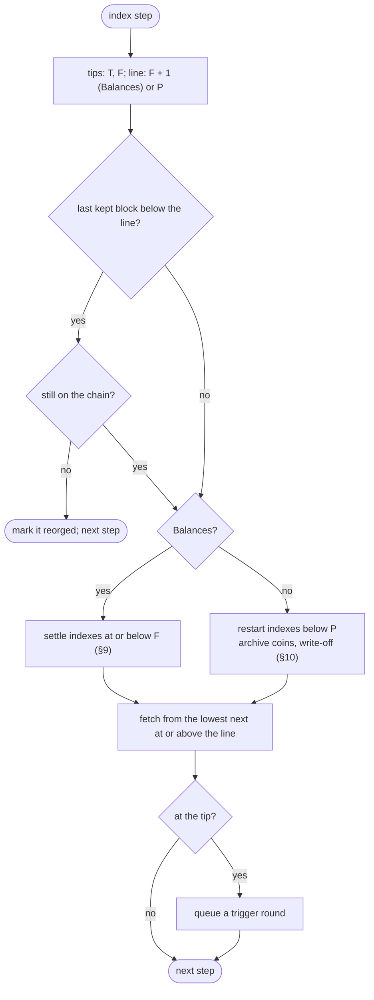
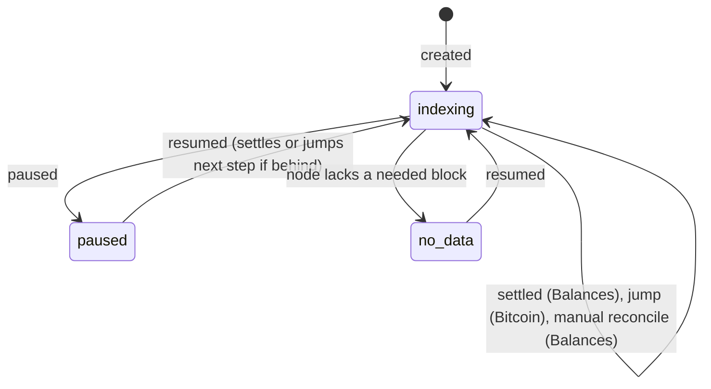

# 083 — Depth limit, balance adjustments, block pruning

Status: agreed. Replaces 079 and 081, which are deleted. The alt design (§6,
§8, §9) replaces the first one (`reconciling`, `carry`, `max_depth` on every
chain): `docs/design/083-migrate-4.sql` brings an existing file to it.

Paths are relative to the repository root. Code is cited by file and symbol.

## 1. Summary

- **Indexing works as today.** One index job per network reads blocks
  forward, stores every block it reads, and catches lagging indexes up
  (`Indexer::fetch`, `sdk/base/src/indexer.rs`).
- **The leg table is the history.** Legs already carry per-index order and
  running totals (072). No new table.
- **Each network has a line;** nothing below it is read:
  - **Chains that can read a balance** (Solana, Ethereum, "alts"): the
    chain's final block `F`. An index whose next block is at or below `F`
    is **settled**: one balance read at a final block, one `adjustment`
    leg, and it reads on from there. A new index, one left behind by an
    outage and a resumed one are all settled the same way.
  - **Bitcoin:** `P = T − max_depth` (`max_depth` in positions, replacing
    `max_history_days`). It limits how far back an index may start, makes
    an index that falls further behind **jump**, and its coins from before
    the gap are **archived**: no longer spendable, written off by one
    `adjustment` leg. Spendable coins are always real; the balance is never
    too high. Coins received inside the gap are missed: an accepted risk.
- **The line is also the prune line:** unused blocks below it are deleted.
- **No lookups into a gap.** What happened inside it is the user's risk.
  Everything before the cut is history; on Bitcoin it is never spendable.
- **Stored blocks may have gaps.** Below the prune line only blocks
  something points to survive.
- **`block.archived_at` (reorgs) is renamed `reorged_at`,** so "archived"
  means one thing: a Bitcoin coin written off by a gap.

**The tradeoff (alts):** an indexer more than `T − F` behind (Solana about
32 slots, about 13 s; Ethereum about 64–96 blocks) settles its wallets: each
gets one adjustment instead of entries for the skipped blocks. Balances stay
right; the per-transaction history of the gap is not kept.

## 2. Terms

| Term | Meaning |
|---|---|
| `T` | The chain's newest block (`Tips::produced`, `sdk/base/src/block.rs`). |
| `F` | The chain's final block, by its own rule (`Tips::confirmed`): Solana `getSlot(finalized)`, Ethereum the `finalized` block, Bitcoin `T − confirmations`. At or below `F` a block is never reorged. Not `network_index.confirmed`, which is `T − confirmations` on every chain. |
| `P` | Bitcoin: `T − max_depth`, its jump line and prune line. |
| `S` | The final block a settle's balance read answers at, `S ≥ F`. |
| birthday | Where an index starts reading (`wallet_index.birthday`). |
| next | The first position an index still has to read (`Index::next`). |
| gap | Blocks an index never read because it jumped or settled. |

**Rule (Bitcoin):** `max_depth ≥ confirmations`, so `P ≤ F`. The config
load refuses less. Everything below `P` is final.

## 3. What does not change

- `Indexer::fetch`: start at the lowest lagging index (`IndexStore::find_next`,
  now from the line up), else at the last kept block; the reorg check on the
  last kept block; marking reorged blocks; `NoData`; `move_birthday` on
  nodes with pruned history.
- `advance` (`apps/server/src/models/wallet_index.rs`): an index moves onto
  a block whose parent is its `indexed_at`, or, unstarted, onto the first
  block at or above its birthday. "First" is now the chain's (the block's
  parent below the birthday), not the store's (no kept block between): an
  unstarted index never skips blocks nobody kept, so a run that starts above
  `F` never moves an index whose next is at or below it.
- Legs, their running totals, and the balance view
  (`wallet_index_with_balance`, `apps/server/init.sql`).
- Every block the indexer reads is stored.

## 4. `max_depth` (Bitcoin)

- `network.max_depth INTEGER` (positions) replaces `max_history_days`.
  NULL: no start limit, no jumps, no pruning.
- `sdk/base`: `NetworkConfig::max_depth` and `Service::max_depth`
  (`Option<u64>`, `sdk/base/src/config.rs`); Bitcoin's `Config::max_depth`
  (`sdk/chains/bitcoin/src/config.rs`). Ethereum and Solana have none:
  their `Service::max_depth` is `None`, their line is `F`.
- The start check (`apps/server/src/usecase/wallets.rs`, `birthday`)
  compares positions directly: no time conversion.
- Seeds (`apps/server/seed.sql`):

  | Network | `confirmations` | `max_depth` | About |
  |---|---|---|---|
  | Bitcoin | 6 | 4,320 | 30 days, today's limit |
  | Ethereum | 12 | NULL | line `F` |
  | Solana | 32 | NULL | line `F` |

## 5. Two kinds of chains

A chain can read a balance when its service has `Balances` (§11).

| | With `Balances` (Solana, Ethereum) | Without (Bitcoin) |
|---|---|---|
| Line | `F + 1` | `P` |
| New index | Starts at `F`, any start (kept as `requested_from`) | Starts at its start; one below `P` refused (400) |
| Index's next at or below the line | Settled at `S`, reads on from `S + 1` (§9) | Below `P`: jumps to `P` (§8) |
| Gap closed by | Balance read, one `adjustment` (§9) | Archived coins, one `adjustment` (§10) |
| Balance before its first block | NULL | NULL |
| Balance after a gap | Exact | Never too high; gap receives missed; negative when history is missing (§10) |
| Pruning | Below `F` | Below `P` |

## 6. Starting an index

**Without `Balances`:** as today. `birthday` = the asked start (absent:
`T`). A start below `P` is refused (400): a new wallet's old coins cannot be
found.

**With `Balances`** (a `WalletIndexTarget` on a chain whose line is
`Line::Final`, kept by `WalletIndexStore::insert`; design 085):

- `requested_from` = the asked start (absent: `T`). It is information.
- `birthday` = `F`; state `indexing`; `indexed_at` unset.
- Its next, `F`, is at or below the line: the next step settles it (§9),
  whatever the wallet: a generated key reads 0.
- Its balances read NULL until then (NULL `indexed_at`, §13).

## 7. The `adjustment` leg

One leg kind, built like a reward: a block, no transaction. Two writers:

| Writer | Chain | Block | Amount | `leg_index` |
|---|---|---|---|---|
| Settle (§9) | Solana, Ethereum | `S` | The chain's balance at `S` minus the index's total | 0 |
| Write-off (§10) | Bitcoin | The index's `indexed_at` at the jump | −Σ the coins archived by the jump | 1 |

Each writer has its own `leg_index`; no other is allowed.

| Column | Value |
|---|---|
| `kind` | 6 `adjustment` |
| `"transaction"` | NULL |
| `id` | `{block}.adjustment.{wallet_index_id}.{leg_index}` |
| `leg_index` | 0 settle, 1 write-off |
| `address`, `asset`, `wallet_index_id` | The index's |
| `amount` | Signed |
| `position`, `seq`, `total*` | As any mined leg: the block's position, the next `seq`, totals carried on (`Leg::follow`): its amount moves `total` only |
| `coin_txid`, `coin_index`, `archived_at` | NULL |

Schema (`apps/server/init.sql`, table `leg`):

```sql
CHECK (kind BETWEEN 0 AND 6),
CHECK (("transaction" IS NULL) = (kind IN (5, 6))),
CHECK (id = CASE kind
    WHEN 6 THEN block || '.adjustment.' || wallet_index_id
    ELSE COALESCE("transaction", block || '.reward')
END || '.' || leg_index),
CHECK (kind <> 6 OR leg_index IN (0, 1)),
```

- **It has a live block,** so every read that filters on live blocks
  (about 30 in `apps/server/src/models/`) counts it unchanged. The balance
  view's signed sum (`IIF(kind IN (1, 2, 4), '-' || amount, amount)`)
  already takes a signed amount, as rewards do.
- **The opening balance is the first adjustment** of an index. One kind.
- **`total_received` / `total_sent` count only what the chain showed:**
  received, minted and reward legs in, spent, burned and fee legs out. An
  adjustment never changes them; it moves only `total`, the balance. So
  `total = total_received − total_sent + Σ the adjustments so far`.
  Example: at block 500 an index has received 30 and sent 10, total 20;
  after an outage the chain reads 25 at block 800: the settle is +5,
  total 25, received still 30, sent still 10. A write-off (§10) likewise
  lowers only `total`.
- **Server only.** `base::Leg` (`sdk/base/src/transaction.rs`) is
  unchanged; the server's leg model, the API's leg kind and the UI have
  `adjustment`.
- **The legs list orders by (`position`, `seq`)** (`leg::db::find_page`,
  its cursor that pair).
- `docs/design/083-migrate-3.sql` rebuilds `leg` of an existing file for
  the new CHECKs (kind 6 and its id, `archived_at`).
- **No migration for the totals rule or the `leg_index` CHECK:** the
  running file has no Bitcoin data, so no write-off; its kept legs keep
  their stored totals, and new legs carry on from them.

## 8. The line

Each step, once `fetch` has the tips and before it reads blocks
(`Indexer::line`, `Indexer::check`, `sdk/base/src/indexer.rs`):

1. **The line:** with `Balances` `F + 1`; else, with `max_depth`, `P`;
   else none.
2. **Check the last kept block.** When it is below the line (the server was
   off), read the chain at its position. Gone: mark it reorged
   (`BlockStore::delete`, as `fetch`'s reorg check does) and end the step
   (`Next::Reorged`); the next step checks the one below. On the chain:
   every block kept below it is final history, so **no leg is deleted**.
   Not served (`NotServed`, a node with pruned history): it is far below
   `F`, so final; it counts as on the chain.
3. **With `Balances`: settle** up to a few indexes whose next is at or
   below `F` (§9).
   **Without (Bitcoin): jump.** Restart every `indexing` index whose next
   is below `P` (`IndexStore::restart(index, P)`, one write each):
   `birthday = P`, `indexed_at = NULL`, `indexing`; the same write archives
   and writes off its coins (§10); `requested_from` and its legs stay. Its
   pending sends (a leg of it spent, burned or a fee) are forgotten at once
   (`transaction::db::find_sent(index)`, then
   `usecase::sdk::transaction_indexes::forget(ids, Why::Jump)`, which deletes them and
   keeps them in `transaction_forgotten`, 084). One mined later, in a block we read,
   comes back like any other mined transaction; one mined inside the gap is
   never seen.

Then `fetch`, after the settles and jumps:

- **Starts at the lowest next at or above the line** (`find_next(network,
  line, last)`), else at the last kept block, and never below the line. An
  index just settled at `S` is read on from `S + 1` in the same step, so it
  is past `F` before `F` moves; an index still at or below `F` (its read not
  answered yet) is never moved by the run (§3).
- **Skips the reorg check of a last kept block below the start:** step 2
  checked it.
- The run's first block may have no stored parent: `block.parent` stays
  NULL. The server's block write (`keep`,
  `apps/server/src/usecase/sdk/blocks.rs`) accepts it above the far older
  last kept block because it accepts gaps (§12).

A paused index is not scanned. Resumed, it is `indexing`; the next step
settles it (alts) or jumps it (Bitcoin) when it is behind the line, else it
catches up from its next as before.



Example (Ethereum, `F` 80 below `T`): the server stops at 1,000 and comes
back at `T` = 5,000, `F` = 4,920.

- Block 1,000 is still on the chain. Every index's next is 1,001: each
  settles, at `S` = 4,920 (or a little above, the chain's finality moving).
- The same step reads 4,921 onward. Blocks 1,001–4,919 are never read or
  stored.
- Each index's legs: everything through 1,000, the adjustment on `S`, then
  new legs.

## 9. Settle (chains with `Balances`)

For each `indexing` index whose next is at or below `F`, at most 8 a step
(`Indexer::settle`):

1. **Read** `Balances::balance(address, asset, at = F)`: the balance at a
   final block `S ≥ F`, with `S`; `None` while the chain has not finalized
   `F`.
2. **Read the block** at `S` (`Chained::block`).
3. **Write, in one transaction** (`IndexStore::settle(index, holding,
   header)`, `apps/server/src/usecase/sdk/indexes.rs`):
   - keep `S` unless it is kept (`keep_bare`, no facts, no index moved,
     linked as every block is); another live block at `S`: `false`;
   - `amount = balance(S) − the index's total` (its live legs; none is
     above `S`: the index never read past its next);
   - insert the `adjustment` on `S`, its totals carried on; already kept:
     `false`;
   - `birthday = S`, `indexed_at = S`: the index continues from `S + 1`;
   - its pending sends stay: since 085 each one's own transaction index
     settles it (the chain's `Confirmer`), where before an index that had
     started forgot them, as §8 does.

`None`, a failed read, no block at `S`, or `false`: the index stays as it
is and is tried next step. A failure is counted in `Stats::failures`, never
failing the step.

- **No totals change.** Nothing above `S` exists for the index, so the
  adjustment is its newest leg: no carry.
- **Legs before the gap keep their totals as observed.** The adjustment
  right after them is the correction.

Example: an imported Solana address holding 5 SOL is added at `T` = 1,032,
`F` = 1,000: `birthday` = 1,000. The next step's finalized read answers 5
at `S` = 1,001: the adjustment on 1,001 is 5; the step reads 1,002 onward,
and 0.2 received at 1,020 makes the total 5.2.

### 9.1 Manual reconcile

Ether a contract sends to a wallet (an exchange paying out through its
contract, a multisig, a WETH unwrap) is not in any block we read: a block
holds transactions as sent (`to` is the contract), and plain ether moved
inside contract code writes no log. Only the wallet's balance shows it
(`sdk/chains/ethereum/src/chain.rs`). It is not supported; the balance then
reads too low.

`POST /v1/wallets/{id}/indexes/{asset}/reconcile` corrects one index on
demand (`usecase::wallets::reconcile`), in one write:

- deletes the index's mined legs above `F` (the indexer's last read,
  `Stats::confirmed`) and unsets its `indexed_at`, its birthday at most
  `F`: its next is at or below `F`, so the next step settles it (§9) and
  reads on from `S + 1`. Pending legs stay.
- Only on chains with `Balances` (Solana, Ethereum); Bitcoin answers 422.
- A paused or `no_data` index answers 422; before the indexer read `F`
  once, 503.
- Nothing runs on a schedule.

## 10. Archived coins (Bitcoin)

Bitcoin has no balance read. A coin from before a gap may have been spent
inside it, and nothing tells us. So the jump treats every such coin as
gone.

**`leg.archived_at INTEGER`:** the position of the jump (`P`) that wrote
the coin off. Set only on `received` legs with a coin:

```sql
CHECK (archived_at IS NULL OR (kind = 0 AND coin_txid IS NOT NULL)),
```

**At the jump,** in the restart's write (`WalletIndexStore::restart`,
`apps/server/src/usecase/sdk/indexes.rs`):

1. Every coin the index's live legs still show as unspent (a `received`
   leg with a coin, no live `spent` leg of the index naming it, not
   archived) gets `archived_at = P` (`leg::db::archive`).
2. One write-off `adjustment` (leg 1) of −Σ those coins on the index's
   `indexed_at` (checked in §8 step 2, final), before it is unset.

No coins or no `indexed_at` (never started): nothing archived, no
write-off.

**Reads:**

- `find_unspent` (`apps/server/src/models/leg.rs`) skips archived coins:
  only coins seen in blocks read after the last gap are spendable.
- Every leg read shows `archived_at` (a `Leg` column), the index legs
  list and transaction reads included.

**A later block spends an archived coin** (someone spent it after the
gap, inside blocks we read), or a coin the index never saw (a re-index
from `P`): its `spent` legs subtract as any other's. Nothing adds the coin
back, and it stays archived, never spendable. The total may go negative:
**a negative Bitcoin total means history is missing.** A reorg of that
block takes the spend back with it.

Spendable is always real; the balance is never too high. The total is the
spendable coins less the archived or unseen coins spent since.

Example (tip 1,000, `max_depth` 100, a wallet indexed through 850):

- Coins: 0.3 (received at 800) and 0.2 (received at 840). Total 0.5.
- `P` = 900. Block 850 is on the chain. The index restarts at 900; both
  coins get `archived_at = 900`; write-off −0.5 on block 850. Total 0.
- Block 950 spends the 0.3 coin: 0.25 out, 0.0499 change back, 0.0001
  fee. The index's legs there: spent −0.2999, fee −0.0001, received
  +0.0499. Total −0.2501, received 0.5499, sent 0.3; spendable 0.0499,
  the change coin. The negative total says history is missing.
- The 0.2 coin, if still unspent, stays invisible: the balance is 0.2 too
  low. Accepted.

## 11. Reading a balance

One optional trait in `sdk/base`, like `Dated`:

```rust
// sdk/base/src/balance.rs
/// One asset of one address at a final block.
pub struct Holding {
    /// The final block it is read at.
    pub position: u64,
    /// Atomic amount.
    pub amount: Decimal,
}

pub trait Balances: Networked + Send + Sync {
    /// The balance at a final block at or above `at`, with that block's
    /// position. `None`: the chain has not finalized `at` yet.
    fn balance<'a>(
        &'a self,
        address: &'a Address,
        asset: &'a Asset,
        at: u64,
    ) -> Future<'a, anyhow::Result<Option<Holding>>>;
}
```

`Service` (`sdk/base/src/config.rs`) has `balances: Option<Arc<dyn
Balances>>`.

| Chain | Read | `S` |
|---|---|---|
| Solana | Native: `getBalance`. Token: Σ `getTokenAccountsByOwner(owner, {mint})`. Both with `commitment: "finalized"` and `minContextSlot = at`; `None` while the node has not reached it (`sdk/chains/solana/src/rpc.rs`). | `context.slot` |
| Ethereum | Native: `eth_getBalance(address, S)`. Token: `eth_call` of `balanceOf(address)` at `S`. `None` while the node's finalized block is below `at`. `S` is about 64–96 blocks below the tip, well inside the about 128 blocks of state a full node keeps. | the node's `finalized` |
| Bitcoin | None: §10. | — |

Later: Solana native reads batch through `getMultipleAccounts` (100
accounts per call) when many indexes settle at once.

## 12. Pruning

The hourly prune job (`apps/server/src/usecase/workers/prune.rs`,
`Prune::line`), per network, in one write, below its line:

- with `Balances`: `F`, its indexer's last read (`Stats::confirmed`; none
  yet: no pruning);
- else with `max_depth`: `P = network_index.tip − max_depth` (no RPC);
- else none.

1. **Reorged blocks below the line:** delete them, their legs and their
   transactions. Final now.
2. **Live blocks below the line that nothing names:** no leg, no
   transaction, no `wallet_index.indexed_at`, and not the network's last
   live block. Delete them.

Both are one `DELETE FROM block` (design 085): the schema's foreign keys
take a deleted block's legs and transactions with it (`ON DELETE
CASCADE`) and set its kept children's `parent` NULL (`ON DELETE SET
NULL`).

Kept forever: every live leg (the history, archived or not), its block and
its transaction.

Why it is safe:

- **Reorgs:** the line is at or below `F`. The reorg walk-back only goes
  above `F`, where every block is kept.
- **`advance`:** an `indexed_at` block is never pruned, so an index always
  finds its parent. An unstarted index moves by the chain's links, not the
  kept blocks (§3).
- **Alts read nothing below `F`:** an index behind it settles instead.
- **Reindexing a new address** (Bitcoin) reads its blocks from the node,
  not the store: stored blocks never held other addresses' transactions.
  Pruned rows are written again, because `keep`
  (`apps/server/src/usecase/sdk/blocks.rs`) accepts gaps: it checks a
  block's link only to an adjacent live neighbour (the one at its parent's
  position below, the one whose parent it is above). An index stays
  contiguous through `advance`. The run's first block has a NULL parent.
- **Deleting is cheap:** `block.parent` and `leg.block` are foreign keys,
  so `init.sql` indexes both (`block_parent`, `leg_block`;
  `docs/design/083-migrate-2.sql` adds them to an existing file).

Effect: Solana's about 93 MB a day of block rows (half of them empty
slots) shrinks to the blocks above `F` plus those with legs; Bitcoin keeps
30 days plus those with legs.

## 13. Index states

`wallet_index.state`: `0 indexing`, `1 paused`, `2 no_data` (`CHECK (state
IN (0, 1, 2))`). Only `indexing` is scanned.

- **Balances read NULL before an index's first block** (NULL
  `indexed_at`): an alt index until its first settle, or after a manual
  reconcile or a reorg below its birthday until it settles again. No number
  beats a wrong one.
- **Triggers skip it** then: their "fully indexed" read needs `indexing`
  and indexed through the confirmed position.



## 14. Reorgs

- **`block.archived_at` becomes `reorged_at`** (`apps/server/init.sql`,
  the doc comments of `BlockStore::delete` and `Stats::reorgs` in
  `sdk/base`). A reorg marks blocks from its fork, as before.
- **A reorg goes to any depth:** a kept block may be gone at or below `F`
  when the node it came from sat on a dead fork past finality.
- **A reorg that takes back an adjustment's block** rewinds the index as
  any reorg does (`wallet_index::db::rewind`): behind its birthday (`S`),
  `indexed_at` unset, its next `S` at or below `F`. The adjustment leaves
  every read with its block, and the next step settles the index again on
  the new branch (§9). A write-off (§10) just leaves with its block.

## 15. API and UI

| Where | Change |
|---|---|
| Network (read and update) | `max_history_days` becomes `max_depth` (positions); NULL on Solana and Ethereum. |
| Blocks | `archived_at` becomes `reorged_at`. |
| `POST /v1/wallets/{id}/indexes` (`apps/server/src/api/wallet_indexes.rs`) | `start` below `P`: 400 (Bitcoin). With `Balances` the index starts at `F` whatever `start` says (kept as `requested_from`); balances NULL until its first settle. |
| `POST /v1/wallets/{id}/indexes/{asset}/reconcile` | §9.1: 202 and the index, its progress unset; 422 on Bitcoin, or when paused or `no_data`; 503 before the indexer read `F`. |
| Index legs | Kind has `adjustment`; `archived_at` on Bitcoin coins. |
| `docs/openapi.json`, `apps/server/ui/src/api/schema.d.ts` | Regenerated. |

## 16. Iterations

Each shipped alone and needed only the ones before it.

| # | What | Crates |
|---|---|---|
| **1** | `max_depth` replaces `max_history_days` (§4); `archived_at` → `reorged_at` (§14) | `sdk/base`, chains, server, API |
| **2** | Pruning (§12) | Server |
| **3** | `Balances` with Solana and Ethereum reads (§11); the `adjustment` leg (§7); settle (§9); the manual reconcile endpoint (§9.1) | `sdk/base`, chains, server, API |
| **4** | The last-block check, `IndexStore::restart` (pending sends forgotten), `fetch` from the line | `sdk/base`, server, seed |
| **5** | Bitcoin's jump (§8): `leg.archived_at`, write-off, `find_unspent` skips archived coins; adjustment id ends in `.{leg_index}` (§7); `083-migrate-3.sql` | `sdk/base`, Bitcoin, server, API |
| **6** | The alt design: line `F`, settle at `S` and read on in the same step, new watches at `F`, no `max_depth`, `reconciling`, `carry` or `STATE_DEPTH` for alts; `advance` by the chain's links; prune below `F`; manual reconcile deletes legs above `F`; `083-migrate-4.sql` | `sdk/base`, Solana, Ethereum, server, API, UI |
| **7** | Adjustments move only `total` (§7); no found adjustment: a spend of an archived coin subtracts, the total may go negative (§10); adjustment `leg_index` 0 or 1 only | Server |

Iteration 6 proves: a new watch settles at `S ≥ F` and reads `S + 1` in
the same step, with no legs before `S`; an index behind `F` after an outage
keeps its old legs and gets one adjustment of the chain's balance less its
total, its pending send forgotten (since 085: left to its transaction
index); a read not answered or failed leaves the
index unread until the next step; a settled index is not settled again as
`F` moves; the run starts from an index just settled; a reorg taking back
an adjustment's block settles again, one live adjustment; a manual
reconcile drops the legs above `F` and the total ends at the chain's
balance; a settle keeps its block when it is not kept.

## 17. Decided

| Question | Decision |
|---|---|
| A separate history table? | No: legs are the history. |
| `total_received` / `total_sent` of an adjustment? | Unchanged: an adjustment moves only `total` (§7). |
| A block spends an archived coin: add it back first (a "found" adjustment)? | No: the spend subtracts as any other; a negative total means history is missing (§10). |
| Bitcoin coins from before a gap: `gettxout` per coin? | No RPC: archived and written off (§10). |
| Bitcoin start older than `P`? | Refused: a new wallet's old coins cannot be found. |
| Delete the tail legs at a jump? | No: the last-block check proves them (§8 step 2). |
| `archived_at` on Solana and Ethereum? | No: the balance read makes them exact. |
| Ether sent by contracts (internal transfers)? | Not supported. No traces, no scheduled re-reads; a manual reconcile (§9.1) corrects one index. |
| Look up what happened inside a gap (our sends by txid, coins by `gettxout`)? | No lookups for wallets. The gap is the user's risk; a jump forgets the index's pending sends (§8). A settle no longer does (085): each pending send's transaction index asks the chain by txid (`Confirmer`). On Bitcoin a send mined inside the gap leaves its change coin unseen, like any gap receive. |
| Alts: a `max_depth` and a `reconciling` state, the totals above the anchor carried? | No: the line is `F`, an index behind it settles at `S` and reads on from `S + 1`, so nothing above `S` exists to carry and its balance is never unknown once settled. |
| Alts: an indexer more than `T − F` behind (Solana about 13 s, Ethereum about 64–96 blocks). | Accepted: its wallets settle, one adjustment each instead of the gap's entries; balances stay right. |
| Bitcoin `max_depth` 4,320: an outage over 30 days writes off every coin. | Accepted; raise per deployment if needed. |

## 18. Open items

- **"Might have balance":** a future API hint beside the sure balance, e.g.
  the sum of an index's archived coins: what a Bitcoin index may still
  hold that the jump wrote off.
