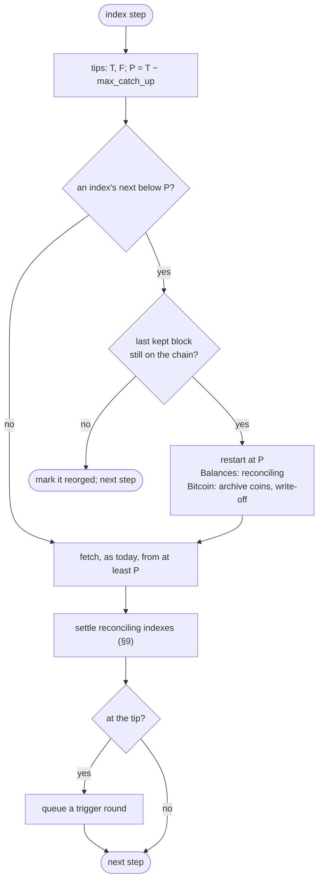
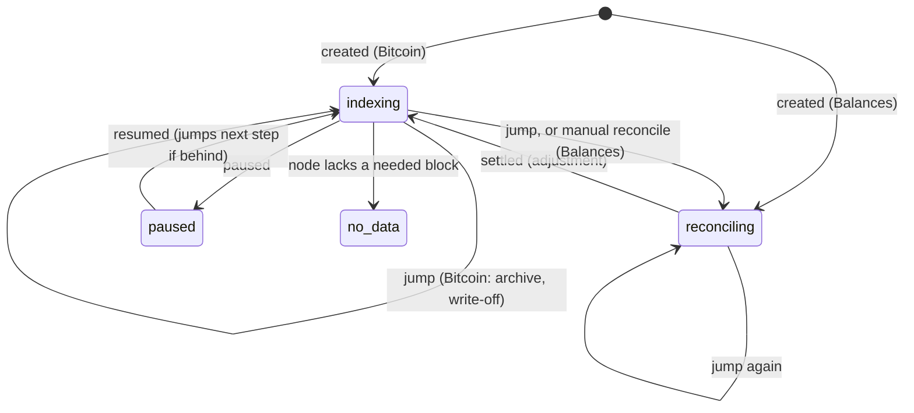

# 083 — Catch-up limit, balance adjustments, block pruning

Status: agreed; nothing built. Replaces 079 and 081, which are deleted.

Paths are relative to the repository root. Code is cited by file and symbol.

## 1. Summary

- **Indexing works as today.** One index job per network reads blocks
  forward, stores every block it reads, and catches lagging indexes up
  (`Indexer::fetch`, `sdk/base/src/indexer.rs`).
- **The leg table is the history.** Legs already carry per-index order and
  running totals (072). No new table.
- **One new setting per network, `max_catch_up`** (positions), replacing
  `max_history_days`. It does three jobs:
  1. limits how far back an index may start;
  2. makes an index that falls further behind **jump** instead of reading
     the gap;
  3. sets the **prune line**: unused blocks older than it are deleted.
- **A gap is closed per chain:**
  - **Chains that can read a balance** (Solana, Ethereum): one balance
    read, one `adjustment` leg. The balance is exact again.
  - **Bitcoin:** the coins from before the gap are **archived**: no longer
    spendable, written off by one `adjustment` leg. Spendable coins are
    always real; the balance is never too high. Coins received inside the
    gap are missed: an accepted risk.
- **No lookups into a gap.** What happened inside it is the user's risk.
  Everything before the cut is history; on Bitcoin it is never spendable.
- **Stored blocks may have gaps.** Below the prune line only blocks
  something points to survive.
- **`block.archived_at` (reorgs) is renamed `reorged_at`,** so "archived"
  means one thing: a Bitcoin coin written off by a gap.

## 2. Terms

| Term | Meaning |
|---|---|
| `T` | The chain's newest block (`Tips::produced`, `sdk/base/src/block.rs`). |
| `F` | The final tip: `T − confirmations` (`Tips::confirmed`, `network_index.confirmed`). At or below `F` a block is never reorged. |
| `P` | `T − max_catch_up`: the jump line and the prune line. |
| `A` | The anchor: the final block a balance read is valid at. |
| birthday | Where an index starts reading (`wallet_index.birthday`). |
| next | The first position an index still has to read (`Index::next`). |
| gap | Blocks an index never read because it jumped. |

**Rule:** `max_catch_up ≥ confirmations`, so `P ≤ F`. The config load
refuses less. Everything below `P` is final.

## 3. What does not change

- `Indexer::fetch`: start at the lowest lagging index (`IndexStore::find_next`),
  else at the last kept block; the reorg check on the last kept block;
  marking reorged blocks; `NoData`; `move_birthday` on nodes with pruned
  history.
- `advance` (`apps/server/src/models/wallet_index.rs`): an index moves onto
  a block whose parent is its `indexed_at`, or, unstarted, onto the first
  live block at or above its birthday.
- Legs, their running totals, and the balance view
  (`wallet_index_with_balance`, `apps/server/init.sql`).
- Every block the indexer reads is stored.

## 4. `max_catch_up`

- `network.max_catch_up INTEGER` (positions) replaces `max_history_days`.
  NULL: no start limit, no jumps, no pruning.
- `sdk/base`: `NetworkConfig::max_history` and `Service::max_history`
  (`Duration`) become `max_catch_up: Option<u64>`
  (`sdk/base/src/config.rs`); each chain's `Config::max_history` likewise
  (`sdk/chains/*/src/config.rs`).
- The start check (`apps/server/src/usecase/wallets.rs`, today through
  `Dated` and `max_history`) compares positions directly: no time
  conversion.
- Seeds (`apps/server/seed.sql`), final values:

  | Network | `confirmations` | `max_catch_up` | About |
  |---|---|---|---|
  | Bitcoin | 6 | 4,320 | 30 days, today's limit |
  | Ethereum | 12 | 100 | 20 minutes |
  | Solana | 32 | 150 | 1 minute |

  Until jumps exist (iteration 4), Solana and Ethereum keep today's 30
  days in positions (Ethereum 216,000; Solana 6,480,000): a small value
  would refuse every start.

## 5. Two kinds of chains

A chain can read a balance when its service has `Balances` (§11).

| | With `Balances` (Solana, Ethereum) | Without (Bitcoin) |
|---|---|---|
| New index, start older than `P` | Accepted, clamped to `P` | Refused (400), as today |
| New index, imported or watch-only | Opens with one balance read | Starts at its birthday, as today |
| Index's next falls below `P` | Jumps to `P` | Jumps to `P` |
| Gap closed by | Balance read, one `adjustment` (§9) | Archived coins, one `adjustment` (§10) |
| State after the jump | `reconciling` until the read | `indexing` at once |
| Balance after a gap | Exact | Never too high; gap receives missed |
| Pruning below `P` | Yes | Yes |

## 6. Starting an index

**Without `Balances`:** as today. `birthday` = the asked start (absent:
`T`). A start below `P` is refused (400): a new wallet's old coins cannot be
found.

**With `Balances`:**

- `requested_from` = the asked start (absent: `T`). It is information.
- `birthday` = `max(requested_from, P)`.
- State `reconciling`, whatever the wallet: a generated key reads 0.
- The existing per-index catch-up reads it forward from `birthday`; §9
  settles it.

## 7. The `adjustment` leg

One new leg kind, built like a reward: a block, no transaction. Three
writers:

| Writer | Chain | Block | Amount |
|---|---|---|---|
| Settle (§9) | Solana, Ethereum | The anchor block | The chain's balance at `A` minus the index's total at `A` |
| Write-off (§10) | Bitcoin | The index's last indexed block | −Σ the coins archived by the jump |
| Found (§10) | Bitcoin | A block that spends archived coins | +Σ those coins |

| Column | Value |
|---|---|
| `kind` | 6 `adjustment` |
| `"transaction"` | NULL |
| `id` | `{block}.adjustment.{wallet_index_id}`: at most one per block and index |
| `leg_index` | 0 |
| `address`, `asset`, `wallet_index_id` | The index's |
| `amount` | Signed |
| `position`, `seq`, `total*` | As any mined leg: the block's position, the next `seq`, totals carried on |
| `coin_txid`, `coin_index`, `archived_at` | NULL |

Schema (`apps/server/init.sql`, table `leg`):

```sql
CHECK (kind BETWEEN 0 AND 6),
CHECK (("transaction" IS NULL) = (kind IN (5, 6))),
CHECK (id = CASE kind
    WHEN 6 THEN block || '.adjustment.' || wallet_index_id
    ELSE COALESCE("transaction", block || '.reward') || '.' || leg_index
END),
```

- **It has a live block,** so every read that filters on live blocks
  (about 30 in `apps/server/src/models/`) counts it unchanged. The balance
  view's signed sum (`IIF(kind IN (1, 2, 4), '-' || amount, amount)`)
  already takes a signed amount, as rewards do.
- **The opening balance is the first adjustment** of an index. One kind.
- **`total_received` / `total_sent` are a best guess:** a positive amount
  adds to `total_received`, a negative one to `total_sent`, so
  `total = total_received − total_sent` still holds.
- **Server only.** `base::Leg` (`sdk/base/src/transaction.rs`) is
  unchanged; the server's leg model, the API's leg kind and the UI gain
  `adjustment`.

## 8. The jump

For every index in state `indexing` or `reconciling` whose next is below
`P`, in `Indexer::next`, before `fetch`:

1. **Check the last kept block first.** When it is below `P` (the server
   was off), read the chain at its position, as `fetch`'s reorg check
   does. Gone: mark it reorged as today and end the step (`Next::Reorged`);
   the next step checks the one below. Only once it is on the chain does
   the jump go on. Then every block we kept below it is on the chain too,
   so **no leg is deleted**: everything the index read is final history.
2. **Restart it** (`IndexStore::restart(index, P)`, one write):
   `birthday = P`, `indexed_at = NULL`. `requested_from` stays. Its
   pending sends are forgotten at once, as the expire job
   (`apps/server/src/usecase/workers/expire.rs`) does at `expires_at`. One
   mined later, in a block we read, comes back like any other mined
   transaction; one mined inside the gap is never seen. Then per chain:
   - **With `Balances`:** state `reconciling`; §9 settles it.
   - **Bitcoin:** in the same write, archive its coins and write them off
     (§10); state stays `indexing`.

A paused index is not scanned. When it is resumed it becomes `indexing`;
the next step jumps it if it is behind. Its blocks were checked while the
network ran, so step 1 has nothing to do.

`Indexer::fetch` changes, on networks with `max_catch_up`:

- **Start at `max(start, P)`.** When every index jumped, `find_next` finds
  nothing at or below the last kept block, and `fetch` would otherwise
  read the whole gap from there.
- **No reorg check on a last kept block below the start:** step 1 already
  checked it, and it is below `F`. Today's check would see it missing from
  the run and mark it reorged.
- The run's first block has no stored parent: `block.parent` stays NULL,
  as for any first block of a run.



Example (Ethereum, `confirmations` 12, `max_catch_up` 100): the server
stops at 1,000 and comes back at `T` = 5,000.

- `P` = 4,900. Block 1,000 is still on the chain. Every index's next is
  1,001: each restarts at 4,900, `reconciling`.
- The step reads 4,900 onward. Blocks 1,001–4,899 are never read or stored.
- `F` = 4,988: each index reads its balance at 4,988 and settles with one
  `adjustment`.
- Each index's legs: everything through 1,000, the legs from 4,900, the
  adjustment on 4,988, then new legs.

## 9. Settle (chains with `Balances`)

For each `reconciling` index, at most K per step:

1. **Read** `Balances::balance(address, asset, from = birthday, through =
   indexed_at)`. The chain answers the amount at a final `A` in that range,
   or `None`: not answerable yet, try again next step.
2. **Find the anchor block:** the last live block at or below `A` and at or
   above `birthday`. None (Solana: only skipped slots so far): try again.
3. **Write, in one transaction** (`IndexStore::settle`):

   ```
   amount = balance(A) − total of the index's last live leg at or below A (none: 0)
   ```

   - insert the `adjustment` leg on the anchor block;
   - add `amount` to `total` (and to `total_received` or `total_sent`) of
     every live leg of the index above the anchor: about `confirmations`
     blocks of one index;
   - state `indexing`.

- **Legs between `birthday` and `A` keep their totals as observed.** The
  adjustment right after them is the correction.
- **Totals change only here,** once, for an index that is `reconciling`:
  its balance reads NULL and triggers skip it, so nothing read the old
  totals.
- **A failed read never fails the step.** The index stays `reconciling`,
  counted in `Stats`.

Example: an imported Solana address holding 5 SOL is added at `T` = 1,000.
`birthday` = 1,000. At 1,032 the finalized read answers 5 at `A` = 1,001;
the index received 0.5 at 1,001 and 0.2 at 1,020. The adjustment on block
1,001 is `5 − 0.5 = 4.5`; the leg at 1,020 moves from total 0.7 to 5.2.

### 9.1 Manual reconcile

Ether a contract sends to a wallet (an exchange paying out through its
contract, a multisig, a WETH unwrap) is not in any block we read: a block
holds transactions as sent (`to` is the contract), and plain ether moved
inside contract code writes no log. Only the wallet's balance shows it
(`sdk/chains/ethereum/src/chain.rs`). It is not supported; the balance then
reads too low.

`POST /v1/wallets/{id}/indexes/{asset}/reconcile` corrects one index on
demand:

- Sets the index to `reconciling`; the next steps settle it as above.
  `birthday` is unchanged; the chain answers at a recent final `A`.
- Only on chains with `Balances` (Solana, Ethereum); Bitcoin answers 422.
- A paused or `no_data` index answers 422.
- Nothing runs on a schedule.

## 10. Archived coins (Bitcoin)

Bitcoin has no balance read. A coin from before a gap may have been spent
inside it, and nothing tells us. So the jump treats every such coin as
gone.

**`leg.archived_at INTEGER`:** the position of the jump (`P`) that wrote
the coin off. Set only on `received` legs with a coin:

```sql
CHECK (archived_at IS NULL OR (kind = 0 AND coin_txid IS NOT NULL)),
```

**At the jump,** in the restart's write:

1. Every coin the index's legs still show as unspent gets `archived_at =
   P`.
2. One write-off `adjustment` of −Σ those coins on the index's last
   indexed block (its `indexed_at`, checked in §8 step 1, final).

**Reads:**

- `find_unspent` (`apps/server/src/models/leg.rs`) skips archived coins:
  only coins seen in blocks read after the last gap are spendable.
- Movement lists show archived legs, marked.

**A later block spends an archived coin** (someone spent it after the
gap, inside blocks we read): the block write (`BlockStore::insert`, the
server's `keep`) adds one found `adjustment` of +Σ the archived coins that
block spends, ordered first among the index's legs of that block. The
spend's legs then subtract the coin as usual: it is counted out once. When
the block is reorged, its found adjustment leaves with it; when it is kept
again, the adjustment is written again with its legs.

**Invariant:** an index's total = Σ its unspent, not archived coins.
Spendable is always real; the balance is never too high.

Example (tip 1,000, `max_catch_up` 100, a wallet indexed through 850):

- Coins: 0.3 (received at 800) and 0.2 (received at 840). Total 0.5.
- `P` = 900. Block 850 is on the chain. The index restarts at 900; both
  coins get `archived_at = 900`; write-off −0.5 on block 850. Total 0.
- Block 950 spends the 0.3 coin: 0.25 out, 0.0499 change back, 0.0001
  fee. The index's legs there: found +0.3, spent −0.2999, fee −0.0001,
  received +0.0499. Total 0.0499: the change coin.
- The 0.2 coin, if still unspent, stays invisible: the balance is 0.2 too
  low. Accepted.

## 11. Reading a balance

One optional trait in `sdk/base`, like `Dated`:

```rust
// sdk/base/src/balance.rs
/// One asset of one address at a final block.
pub struct Holding {
    /// A: final, `from <= A <= through`.
    pub position: u64,
    /// Atomic amount.
    pub amount: Decimal,
}

pub trait Balances: Networked + Send + Sync {
    /// The balance at a final block in `from..=through`.
    /// `None`: not answerable in that range yet.
    fn balance<'a>(
        &'a self,
        address: &'a Address,
        asset: &'a Asset,
        from: u64,
        through: u64,
    ) -> Future<'a, anyhow::Result<Option<Holding>>>;
}
```

`Service` (`sdk/base/src/config.rs`) gains `balances: Option<Arc<dyn
Balances>>`.

| Chain | Read | `A` |
|---|---|---|
| Solana | Native: `getBalance`. Token: Σ `getTokenAccountsByOwner(owner, {mint})`. Both with `commitment: "finalized"` and `minContextSlot = from`; `None` when `context.slot > through`. The RPC client keeps `context`, dropped today (`sdk/chains/solana/src/rpc.rs`). | `context.slot` |
| Ethereum | Native: `eth_getBalance(address, A)`. Token: `eth_call` of `balanceOf(address)` at `A`. Full nodes keep about 128 blocks of state; `A` is about `confirmations` below the tip. | `min(F, through)` |
| Bitcoin | None: §10. | — |

Later: Solana native reads batch through `getMultipleAccounts` (100
accounts per call) when many indexes settle at once.

## 12. Pruning

The hourly prune job (`apps/server/src/usecase/workers/prune.rs`) gains,
per network with `max_catch_up` set, in one write, with
`P = network_index.tip − max_catch_up` (no RPC):

1. **Reorged blocks below `P`:** delete them, their legs and their
   transactions. Final now.
2. **Live blocks below `P` that nothing names:** no leg, no transaction,
   no `wallet_index.indexed_at`, and not the network's last live block.
   First set `parent = NULL` on their kept children (`block.parent` is a
   foreign key), then delete them.

Kept forever: every live leg (the history, archived or not), its block and
its transaction.

Why it is safe:

- **Reorgs:** `P ≤ F`. The reorg walk-back only goes above `F`, where
  every block is kept.
- **`advance`:** an `indexed_at` block is never pruned, so an index always
  finds its parent. An unstarted index reads from its birthday, because
  `fetch` starts at the lowest next.
- **Reindexing a new address** reads its blocks from the node, not the
  store: stored blocks never held other addresses' transactions. Pruned
  rows are written again; the run's first block has a NULL parent.

Effect: Solana's about 93 MB a day of block rows (half of them empty
slots) shrinks to the last 150 blocks plus those with legs; Bitcoin keeps
30 days plus those with legs.

## 13. Index states

`wallet_index.state` gains `3 = reconciling` (`CHECK (state IN (0, 1, 2,
3))`); `IndexState::Reconciling` in `sdk/base/src/wallet.rs`. Only chains
with `Balances` use it.

- **Scanned like `indexing`:** `advance` and `find_next` read state 0 or 3.
- **Balance reads NULL:** no number beats a wrong one.
- **Triggers skip it:** their "fully indexed" read adds `state = 0`.
- **Sends from it are refused** (422).



## 14. Reorgs

- **`block.archived_at` becomes `reorged_at`** (`apps/server/init.sql`,
  about 23 uses in `apps/server/src/`, the doc comments of
  `BlockStore::delete` and `Stats::reorgs` in `sdk/base`). Nothing else
  changes: a reorg marks blocks from its fork, as today.
- **Marking a block at or below `F` reorged is an error,** not a rewind:
  `fetch` refuses it. Adjustments sit on final blocks; reorging one would
  silently undo the correction. A node reorging a final block fails
  loudly. The jump's check (§8 step 1) is the one exception: its block is
  below `P` only because the server was off, and is not yet known to be on
  the chain.

## 15. API and UI

| Where | Change |
|---|---|
| Network (read and update) | `max_history_days` becomes `max_catch_up` (positions). |
| Blocks | `archived_at` becomes `reorged_at`. |
| `POST /v1/wallets/{id}/indexes` (`apps/server/src/api/wallet_indexes.rs`) | `start` below `P`: 400 without `Balances`; clamped with `Balances`. The description says which. |
| Wallet index | State gains `reconciling`; balances NULL while in it. |
| `POST /v1/wallets/{id}/indexes/{asset}/reconcile` | New (§9.1): 202 and the index, now `reconciling`; 422 on Bitcoin, or when paused or `no_data`. |
| Index legs | Kind gains `adjustment`; `archived_at` on Bitcoin coins. |
| `docs/openapi.json`, `apps/server/ui/src/api/schema.d.ts` | Regenerated. |

## 16. Iterations

Each ships alone and needs only the ones before it.

| # | What | Crates | Proves |
|---|---|---|---|
| **1** | `max_catch_up` replaces `max_history_days` (§4), seeds keep 30 days in positions; `archived_at` → `reorged_at` (§14) | `sdk/base` (approved), chains, server, API | A start below `P` is refused; NULL means no limit; reorgs behave as before |
| **2** | Pruning (§12) | Server | Balances, movements and unspent coins are equal before and after a prune; pruning twice changes nothing; a new index over a pruned range gets the same legs as over an unpruned one |
| **3** | `Balances` with Solana and Ethereum reads (§11); state `reconciling` (§13); the `adjustment` leg (§7); settle (§9); new indexes on those chains start clamped and reconciling (§6); reorging at or below `F` refused (§14); the manual reconcile endpoint (§9.1) | `sdk/base` (approved), chains, server, API | A watch-only address holding 5 opens at 5; a generated one at 0; a read beyond `through` retries; triggers skip a reconciling index; a manual reconcile of an index 0.5 short appends +0.5 |
| **4** | The jump for chains with `Balances` (§8): the last-block check, `IndexStore::restart`, `fetch` from at least `P`; Solana and Ethereum seeds lowered | `sdk/base` (approved), server, seed | 4,000 blocks behind with 100: every index jumps, the gap is never read, one adjustment each, balances equal the chain's |
| **5** | The Bitcoin jump (§10): `leg.archived_at`, write-off, found adjustments, `find_unspent` skips archived coins | Server | §10's example: total 0.0499 and only the change coin spendable; reorging block 950 drops its found adjustment and keeps the coin archived |

Before iteration 4, route Solana `getBlock` over two or more nodes
(`network_endpoint_route`), so live reading keeps up and jumps stay rare.

`sdk/base` changes (approved, §17):

- **1:** `NetworkConfig::max_history` and `Service::max_history` become
  `max_catch_up: Option<u64>`; doc comments say "reorged".
- **3:** `balance.rs` (`Balances`, `Holding`); `Service::balances`;
  `IndexState::Reconciling`; `IndexStore::settle`; the settle in
  `Indexer::next`; `fetch` refusing to reorg at or below `F`.
- **4:** `IndexStore::restart`; the jump and its last-block check in
  `Indexer::next`; `fetch` starting at `max(start, P)` and skipping the
  reorg check below it. Iteration 5 reuses them: Bitcoin's archive and
  write-off are the server's part of `restart`.

## 17. Decided

| Question | Decision |
|---|---|
| A separate history table? | No: legs are the history. |
| `total_received` / `total_sent` of an adjustment? | A best guess, by sign. |
| Bitcoin coins from before a gap: `gettxout` per coin? | No RPC: archived and written off (§10). |
| Bitcoin start older than `P`? | Refused: a new wallet's old coins cannot be found. |
| Delete the tail legs at a jump? | No: the last-block check proves them (§8 step 1). |
| `archived_at` on Solana and Ethereum? | No: the balance read makes them exact. |
| Ether sent by contracts (internal transfers)? | Not supported. No traces, no scheduled re-reads; a manual reconcile (§9.1) corrects one index. |
| Look up what happened inside a gap (our sends by txid, coins by `gettxout`)? | No lookups. The gap is the user's risk; the jump forgets the index's pending sends (§8). On Bitcoin a send mined inside the gap leaves its change coin unseen, like any gap receive. |
| The `sdk/base` changes of iterations 1, 3 and 4 (§16)? | Approved. `Balances` is optional per chain, like `Dated`. |
| Solana `max_catch_up` 150: any outage over a minute jumps every index and loses that gap's per-transaction detail. | Accepted. Start at 150; raise once routing shows the read rate holds. |
| Bitcoin `max_catch_up` 4,320: an outage over 30 days writes off every coin. | Accepted; raise per deployment if needed. |

No open questions.
