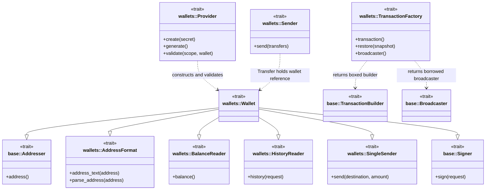
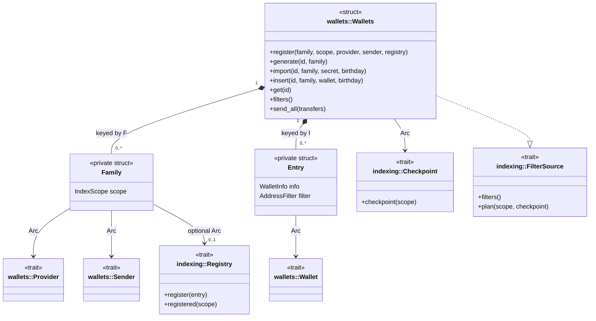
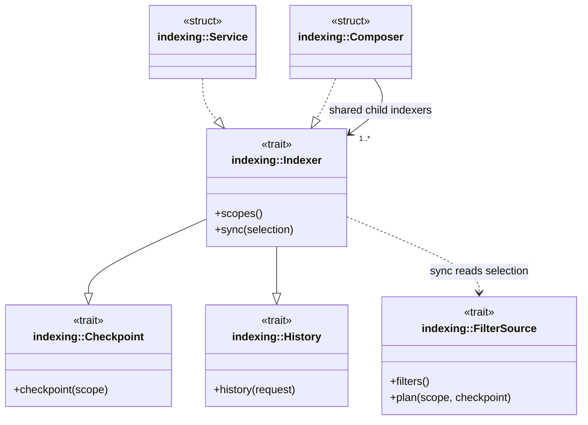
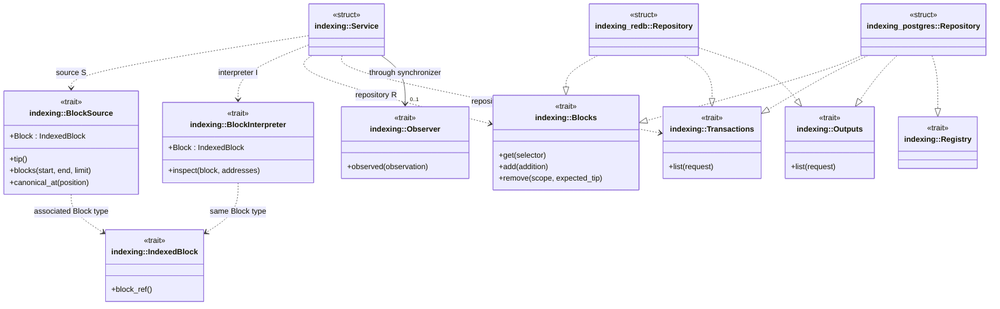

# Wallet and indexing examples

These examples show local key generation, operational wallets, and the
`wallets::Wallets<I, F>` collection for Bitcoin and Ethereum.

## SDK trait map

The diagrams below cover all **8 traits declared by `sdk/wallets`** and all
**12 traits declared by `sdk/indexing`**, including its nested crates. The
PostgreSQL, redb, and runtime crates implement or consume these contracts;
they declare no additional traits. Supporting structs and imported `base`
traits are labelled separately.

Methods retain their source names, but omit Rust receivers, lifetimes,
`Result`/future wrappers, and most parameter types for readability. `Wallet`
and `Indexer` inherit capabilities through supertraits. Other arrows describe
implementation, ownership, or a dependency, not inheritance.

| UML notation | Meaning |
| --- | --- |
| `Child --|> Parent` | A trait requires another trait as a supertrait. |
| `Type ..|> Trait` | A concrete type implements a trait. |
| `Owner *-- Member` | A struct owns its member or collection entries. |
| `Type --> Trait` | A stored reference, commonly `Arc<dyn Trait>`. |
| `Type ..> Trait` | A method or implementation uses the other contract. |

### 1. Wallet traits



`Wallet` declares no methods of its own. A type satisfying its six capability
supertraits and `Send + Sync + Any` automatically implements it through a
blanket implementation. The other seven wallet traits require `Send + Sync`.

`Provider::create` and `generate` return `Arc<dyn Wallet>`. `Sender` handles a
batch of `Transfer` values, each carrying a wallet reference. `SingleSender`
handles one transfer from one wallet.

`TransactionFactory` is a separate capability: it is **not a supertrait of
`Wallet`**. It returns a `Box<dyn base::TransactionBuilder>` from `transaction`
and `restore`, and a borrowed `&dyn base::Broadcaster` from `broadcaster`.
These imported base traits are shown only as dependencies, without expanding
their own APIs.

| Traits declared in `wallets` | Source |
| --- | --- |
| `Wallet`, `BalanceReader`, `HistoryReader`, `SingleSender`, `TransactionFactory` | [wallet.rs](../sdk/wallets/src/wallet.rs) |
| `AddressFormat` | [address.rs](../sdk/wallets/src/address.rs) |
| `Provider` | [provider.rs](../sdk/wallets/src/provider.rs) |
| `Sender` | [sender.rs](../sdk/wallets/src/sender.rs) |

`Addresser` and `Signer` belong to
[base/address.rs](../sdk/chains/base/src/address.rs) and
[base/signer.rs](../sdk/chains/base/src/signer.rs), respectively.

### 2. The wallet collection connects to indexing



`I` is the application's wallet ID type, such as `&str` with the value
`"alice"`; it is not an indexer. `F` is the configured family key, such as
`WalletAsset::Btc` or `WalletAsset::Eth`. The checkpoint capability is passed
separately to `Wallets::new(checkpoints)`.

Registering a family does not create a wallet. `Wallets::generate` asks its
provider to construct an operational wallet, stores it in an `Entry`, and
returns `WalletInfo`. `get` also returns metadata. `balance`, `history`, and
`send` delegate to the stored wallet; `send_all` uses the family's batch sender.

`Wallets` implements both `FilterSource` methods. It supplies the complete
address/birthday selection and coordinates its publication through `plan`.
The collection stores per-scope admission state, omitted from this diagram.
The checkpoint is used to assign generated wallets their starting position.
`Wallets` does not implement `Indexer` or run synchronization.

`Registry` is optional per family. It supports the collection's durable
`adopt`/`restore` path; `generate` and `insert` do not persist keys through it.
The sample registrations pass `None`.

Source: [collection storage and methods](../sdk/wallets/src/wallets.rs),
[batch routing](../sdk/wallets/src/wallets/batch.rs),
[FilterSource implementation](../sdk/wallets/src/selection.rs),
[Registry contract](../sdk/indexing/src/registry.rs).

### 3. The public indexing interface



`Indexer` combines checkpoint lookup, history queries, scope discovery, and
synchronization. Both `Service` and `Composer` explicitly implement
`Checkpoint`, `History`, and `Indexer`; the diagram omits the redundant
implementation arrows to the two supertraits.

`Service<S, I, R>` supplies one scope's implementation. Bitcoin and Ethereum
expose `Indexer` type aliases to this service with their native source and
interpreter. `Composer` routes the same interface across multiple indexers.
`Service` is publicly re-exported with `#[doc(hidden)]`.

`FilterSource::plan` has a default implementation based on `filters`.
`Wallets` overrides it for coordinated address admission. The runtime's
`run` function drives `Indexer::sync` with a `FilterSource`; it is a free
function, not another trait.

`indexing::History` returns indexed transaction pages. It is distinct from
`wallets::HistoryReader`, which returns wallet-facing history, and from
`wallets::History`, which is a result struct rather than a trait.

Source: [Indexer, Checkpoint, History](../sdk/indexing/src/indexer.rs),
[FilterSource and Service](../sdk/indexing/src/service.rs),
[Composer](../sdk/indexing/src/composer.rs),
[runtime](../sdk/indexing/runtime/src/lib.rs).

### 4. Indexing source and persistence traits



The service delegates to its private synchronizer and query implementation.
Its `Indexer` implementation requires `S: BlockSource<Block = I::Block>`,
`I: BlockInterpreter`, and `R: Blocks + Transactions`. The `Block` members
above are associated types, not stored fields; source and interpreter must
agree on the same native block type.

`Blocks::add` atomically commits history, live outputs, rollback data, and the
checkpoint. `remove` restores the previous state from storage-owned rollback
data. `Transactions::list` reads canonical history; `Outputs::list` reads live
outputs. **`Outputs` is not a supertrait of `Indexer` or a requirement of
`Service`**; Bitcoin consumes it separately for UTXOs.

`Observer` is an optional callback after an applied block is durably committed.
It reports inclusion, not confirmation depth. `Registry` is used by the wallet
collection, not by the synchronization service. The PostgreSQL repository
currently implements it; the redb repository does not.

All indexing traits require `Send + Sync`, directly or through `Indexer`'s
supertraits. `IndexedBlock` additionally requires `Clone + 'static`.

| Traits declared in `indexing` | Source |
| --- | --- |
| `Checkpoint`, `History`, `Indexer` | [indexer.rs](../sdk/indexing/src/indexer.rs) |
| `FilterSource` | [service.rs](../sdk/indexing/src/service.rs) |
| `IndexedBlock`, `BlockSource`, `BlockInterpreter` | [source.rs](../sdk/indexing/src/source.rs) |
| `Blocks` | [block.rs](../sdk/indexing/src/block.rs) |
| `Transactions` | [observation.rs](../sdk/indexing/src/observation.rs) |
| `Outputs` | [output.rs](../sdk/indexing/src/output.rs) |
| `Observer` | [observer.rs](../sdk/indexing/src/observer.rs) |
| `Registry` | [registry.rs](../sdk/indexing/src/registry.rs) |

Repository implementations: [redb](../sdk/indexing/redb/src/repository/mod.rs),
[PostgreSQL](../sdk/indexing/postgres/src/lib.rs).

## Local keys and operational wallets

Bitcoin and Ethereum expose a local `KeyPair` with address and signing
capabilities. Local generation requires no RPC, storage, or indexer.

```text
KeyPair::generate(...)
    -> local key and address
    -> provider.attach(key)
    -> Arc<dyn wallets::Wallet>
    -> wallets.insert(id, family, wallet, birthday)
    -> registered wallet and indexing filter
```

`attach` is a method on each concrete provider, not on the shared `Provider`
trait. It consumes the key and binds it to the provider's configuration and
services without I/O. Attachment alone does not register an indexing filter.
The collection's `insert` validates and retains the attached wallet with the
caller's explicit birthday.

Bitcoin's public `WalletProvider` name re-exports its internal `Factory`.
Its wallets share UTXOs, fees, transactions, and indexed history. Ethereum's
wallets share accounts, a transaction coordinator, and indexed history.
Neither chain exposes its concrete operational `Wallet` type publicly.

Source: [Bitcoin provider](../sdk/chains/bitcoin/src/wallet/provider.rs),
[Ethereum provider](../sdk/chains/ethereum/src/wallet/mod.rs),
[public contracts](../docs/CONTRACTS.md).

## Run the collection samples

[wallets-collections.rs](wallets-collections.rs) contains two independent
functions:

- `bitcoin_wallet_collections()`
- `ethereum_wallet_collections()`

Uncomment the desired call in `main`, then run from the repository root:

```sh
cargo run --locked -p payment-examples --bin wallets_collections
```

Both calls are commented by default. Each sample follows the same steps:

1. Construct the chain's provider, checkpoint capability, and scope.
2. Register its family and batch sender in a new `Wallets` collection.
3. Generate wallets named `alice` and `bob`.
4. Retrieve Alice's public metadata by ID.
5. Print the address/birthday filters for indexing.

Bitcoin requires a synchronized, unpruned Bitcoin Core 31.x regtest node with
synchronized `txindex`, RPC port `18443`, and the sample's `bitcoin`/`bitcoin`
RPC credentials. Ethereum requires local Anvil on port `8545`:

```sh
anvil --host 127.0.0.1 --port 8545 --chain-id 31337 --hardfork cancun --timestamp 0
```

The samples use separate redb files under `.redb-data`, but do not start
synchronization or submit transfers. They print public wallet metadata and
filters. Generated keys and wallet registrations remain in memory and are
dropped when the process exits; the redb files do not make these wallets
restart-recoverable.

## Other runnable wallet examples

| Source | Command from the repository root |
| --- | --- |
| [bitcoin.rs](bitcoin.rs) | `cargo run --locked -p payment-examples --bin bitcoin_wallet` |
| [ethereum.rs](ethereum.rs) | `cargo run --locked -p payment-examples --bin ethereum_wallet` |

Review each file's `main` to select the sample to run and its header for the
required local setup.
